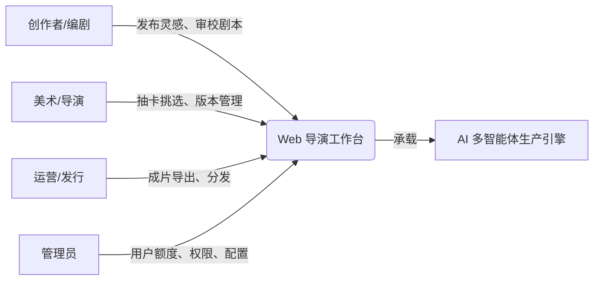
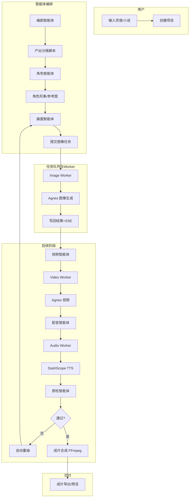
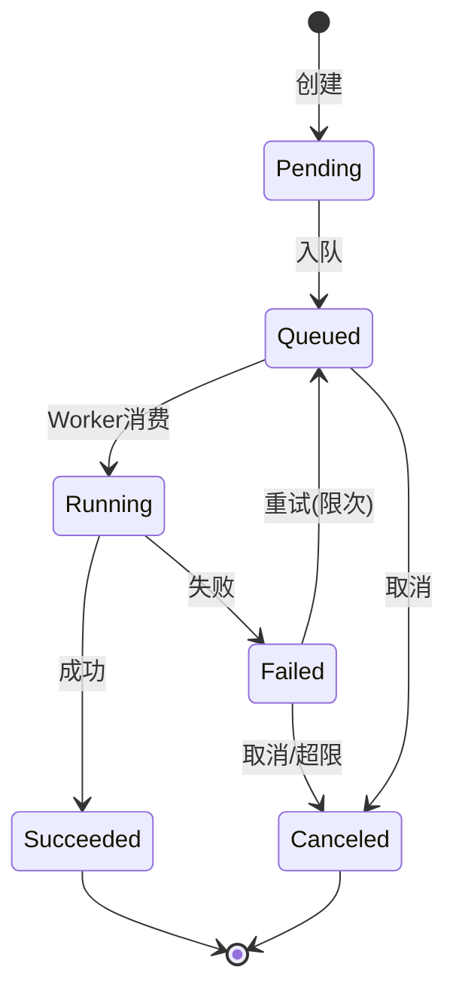
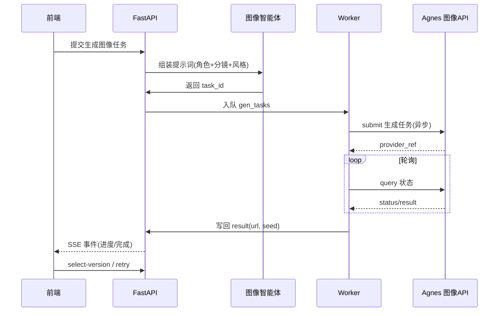
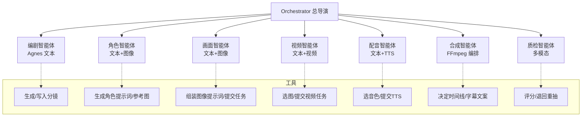
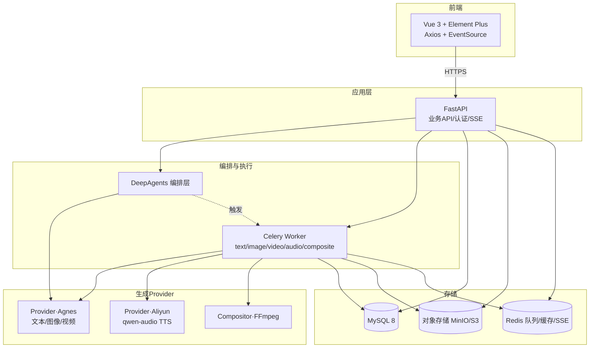
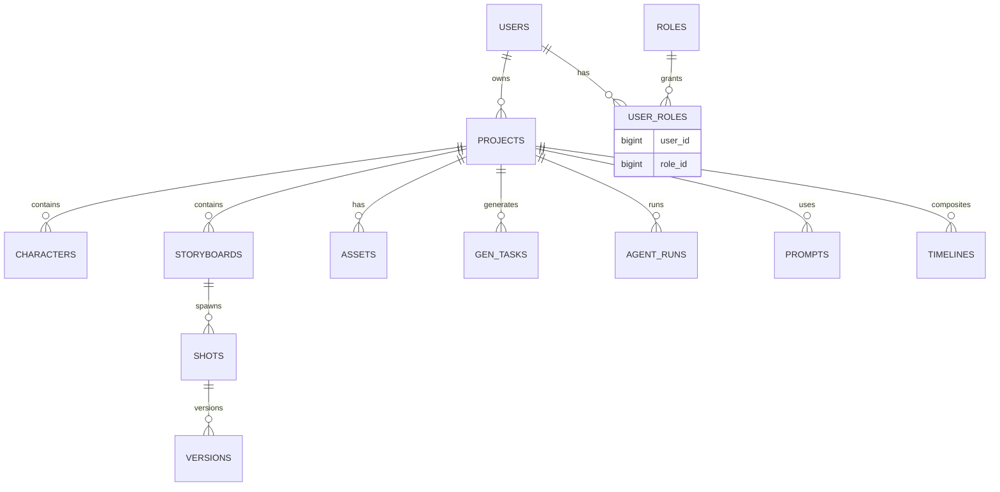
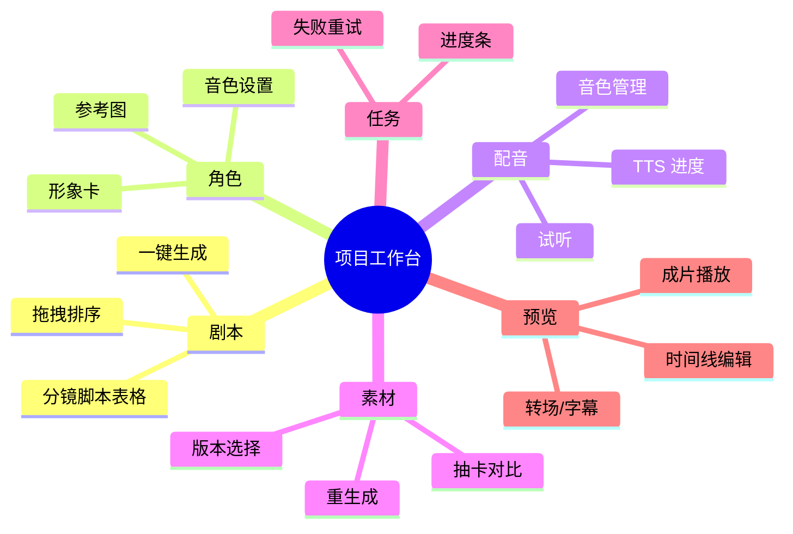
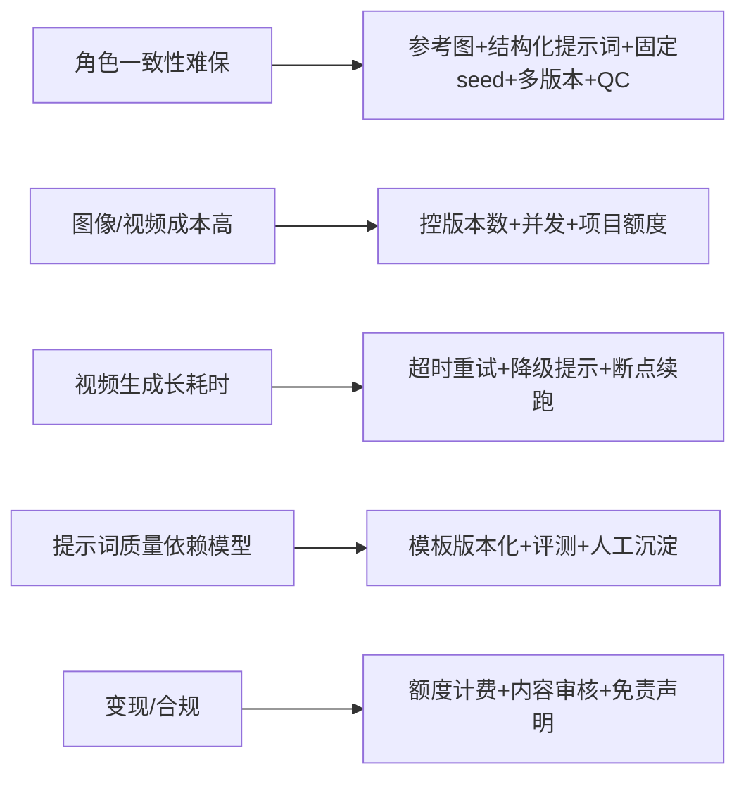
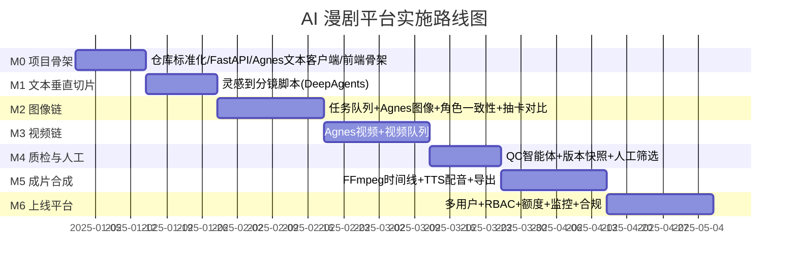

# AI 漫剧智能制作平台 · 产品需求文档（PRD）

> 文档版本：v1.4 ｜ 状态：评审稿 ｜ 更新日期：2026-09-04 ｜ 变更：产品定位由「C 端消费者平台（看剧+创作）」调整为**纯 AI 创作平台**，删除「剧库」模块及「我的」中的追更/收藏/历史等消费端概念，顶栏导航收敛为 3 项（工作台/创作/我的）；此前 V1.3 已升级为 Apple Dark 双主题、「设置」下沉「我的」、封面采用渐变占位
> 技术栈：FastAPI + DeepAgents + 多模态大模型（Agnes AI）+ 阿里云 DashScope TTS + FFmpeg + MySQL 8 + Vue 3 + Element Plus
> 配套设计：页面清单与线框图、V1.4 高保真原型（Apple Dark 双主题）、V1.2 浅色版及独立登录页原型均为早期设计稿，**未随本仓库提供**；当前实现以本仓库源码与 [README.md](README.md) 为准。

---

## 目录

1. [文档说明与术语](#1-文档说明与术语)
2. [产品概述](#2-产品概述)
3. [背景与痛点](#3-背景与痛点)
4. [产品目标与成功指标](#4-产品目标与成功指标)
5. [目标用户与用户画像](#5-目标用户与用户画像)
6. [产品范围与版本规划](#6-产品范围与版本规划)
7. [核心业务流程](#7-核心业务流程)
8. [功能需求](#8-功能需求)
9. [AI 智能体编排设计](#9-ai-智能体编排设计)
10. [业务规则](#10-业务规则)
11. [技术架构方案](#11-技术架构方案)
12. [数据模型](#12-数据模型)
13. [接口设计摘要](#13-接口设计摘要)
14. [前端页面需求](#14-前端页面需求)
15. [非功能需求](#15-非功能需求)
16. [监控与可观测性](#16-监控与可观测性)
17. [成本治理](#17-成本治理)
18. [风险与合规](#18-风险与合规)
19. [实施路线图](#19-实施路线图)
20. [附录：术语表与接口清单](#20-附录术语表与接口清单)

---

## 1. 文档说明与术语

### 1.1 编写目的
明确 AI 漫剧智能制作平台的**产品定位、业务流程、功能/非功能需求、技术架构、数据模型、实施计划**，作为研发、设计、测试与运营的统一依据。

### 1.2 读者对象
- 产品 / 项目负责人
- 后端 / 前端 / 算法与智能体编排工程师
- 测试、运维、运营
- 商务与合规人员

### 1.3 术语表

| 术语 | 解释 |
|---|---|
| 漫剧 | 漫画分镜 + 短视频动效 + 配音配乐 + 字幕的竖屏短剧形态 |
| 分镜（Storyboard） | 每个镜头的最小单元，含景别、画面描述、台词、情绪等 |
| 镜头产物（Shot） | 某一分镜经过生成后得到的图/视频，可拥有多个版本 |
| 抽卡 | 对同一镜头生成多个候选版本，由 QC 或人工挑选 |
| 一致性（Character Consistency） | 同一角色跨镜头长相、画风保持一致 |
| Provider 抽象层 | 封装不同生成平台（Agnes / 阿里云）的统一调用接口 |
| QC | Quality Control，质检，判定产物质量并决定是否重抽 |
| 时间线（Timeline） | 将已选镜头/图/视频/音频/字幕编排成片的顺序化清单 |
| 成片合成 | 用 FFmpeg 将时间线渲染成最终成片的确定性工程 |
| Agent / 智能体 | 由 DeepAgents 编排的、能调用工具与子智能体的自动化单元 |

---

## 2. 产品概述

### 2.1 一句话定位
一个 **AI 漫剧智能制作平台**：输入故事灵感（一句话 / 一段小说 / 一个梗概），通过多智能体编排 + 多模态大模型，自动产出剧本、分镜、角色、画面、动效、配音与最终成片，并提供人机协作的「导演工作台」供人工审校、抽卡、挑选与把关。

### 2.2 产品形态
B 端 / SaaS 化的 **Web 导演工作台**（多用户、可上线），可进行单项目的半自动/全自动生产，并可横向扩展与运营治理。

### 2.3 核心能力
- 从灵感批量产出剧本与分镜脚本
- 角色视觉一致性与参考图管理
- 分镜画面多版本生成（抽卡）
- 图生视频（动效化）
- 角色配音（TTS）
- FFmpeg 成片合成（时间线拼接、字幕、音画混合）
- 人工审校、版本管理、成片导出

---

## 3. 背景与痛点

| 环节 | 传统痛点 | AI 方案价值 |
|---|---|---|
| 剧本创作 | 编剧成本高、周期长 | 智能体批量产出剧本/分镜草稿 |
| 分镜绘制 | 原画师人力成本高、风格难统一 | 多模态大模型生成，风格模型锁定 |
| 角色一致性 | 跨镜头角色容易崩坏 | 参考图 + 结构化提示词 + fixed seed + QC |
| 动效/视频 | 需动画师逐帧制作 | 图生视频自动动效化 |
| 配音 | 需声优录制，周期长成本高 | TTS 合成 + 音色克隆 |
| 剪辑合成 | 需剪辑师手工拼接 | FFmpeg 时间线自动合成 |
| 批量产能 | 单条内容产能有限 | 异步任务队列 + Worker 并行扩产 |

---

## 4. 产品目标与成功指标

### 4.1 产品目标
- **自动化**：一条灵感 → 半自动/全自动产出成片
- **高效率**：显著缩短单集制作周期（目标中期单集制作耗时下降 60%+）
- **一致可控**：角色一致性与画风统一达到可上线水准
- **可协作**：导演人工把控质量，批量初稿由 AI 完成
- **可扩展**：任务与 Worker 可横向扩展，支持平台化运营

### 4.2 关键成功指标（KPI）

| 指标 | 定义 | 目标 |
|---|---|---|
| 分镜脚本生成成功率 | 成功产出分镜脚本的项目占比 | ≥ 95% |
| 镜头一次性达标率 | 单次生成即通过 QC 的比例 | ≥ 60% |
| 角色一致性达标率 | QC 一致性达标抽数 / 总抽数 | ≥ 85% |
| 单集制作周期 | 从灵感到成片耗时 | 缩短 60%+ |
| 配音合成成功率 | TTS 任务成功占比 | ≥ 97% |
| 成片合成成功率 | FFmpeg 合成任务成功占比 | ≥ 99% |
| 单位内容成本 | 单集平均生成费用 | 逐步下降 |
| 用户留存 / 活跃 | 周活跃创作者与项目数 | 上线后 8 周内持续上升 |

---

## 5. 目标用户与用户画像

### 5.1 用户角色



### 5.2 画像说明

| 角色 | 目标 | 关注点 |
|---|---|---|
| 创作者 / 编剧 | 快速把灵感变成剧本与分镜 | 生成质量、可编辑性 |
| 美术 / 导演 | 控制角色一致性、构图与风格 | 抽卡对比、版本管理 |
| 运营 / 发行 | 高效产出可上线成片 | 成片质量、导出速度 |
| 管理员 | 治理费用、权限与配额 | 额度、限额、监控、合规 |

---

## 6. 产品范围与版本规划

### 6.1 MVP（最小可行产品）
- 单用户（或弱权限）项目创建 + 剧本/分镜生成
- 角色设定与参考图
- 分镜图像生成 + 抽卡对比
- 图生视频
- 快速预览（不一定要完整成片）
- 人工挑选/重抽

### 6.2 V1（可上线平台）
- 多用户登录 + RBAC 权限 + 额度计费
- 完整流水线（含配音 TTS 与 FFmpeg 成片合成）
- 时间线编辑器 + 成片导出
- 监控告警 + 内容合规

### 6.3 V2+（演进）
- 批量/多集流水线
- 数据分析与爆款题材推荐
- 更精细的角色一致性（LoRA 定制）
- 多风格模型 / 多供应商热切换

---

## 7. 核心业务流程

### 7.1 端到端生产流程（泳道图）



### 7.2 任务状态机



### 7.3 单镜头生成时序（图像为例）



---

## 8. 功能需求

> 需求优先级：P0（MVP 必须）｜P1（V1 必须）｜P2（演进）
> 说明：本节为**底层 AI 生产功能**（FR），在 **C 端**统一由「**创作 → 作品管理**」承载（剧本 / 分镜 / 角色 / 画面(抽卡) / 配音 / 成片 六模块，见 [`redesign-app.html#create`](redesign-app.html#create)）；QC、任务中心、用户/系统管理等 B 端/后台功能不暴露给 C 端。

### 8.1 项目与项目管理（P0）

| 编号 | 功能 | 描述 | 优先级 |
|---|---|---|---|
| FR-101 | 创建项目 | 输入标题/题材/风格/比例/原始灵感 | P0 |
| FR-102 | 项目列表与详情 | 按状态/所有者筛选，查看进度 | P0 |
| FR-103 | 编辑项目 | 修改标题/风格/比例/配音配置 | P0 |
| FR-104 | 删除项目 | 软删除，保留审计 | P1 |
| FR-105 | 一键流水线 | 触发完整生产管线 | P1 |
| FR-106 | 断点续跑 | 从中断阶段恢复 | P1 |

### 8.2 剧本与分镜脚本（P0）

| 编号 | 功能 | 描述 | 优先级 |
|---|---|---|---|
| FR-201 | AI 生成分镜脚本 | 由 `Agnes 2.5 Flash` 从灵感生成结构化分镜 | P0 |
| FR-202 | 分镜脚本编辑 | 表格化编辑镜头/景别/画面/台词/情绪 | P0 |
| FR-203 | 分镜排序 | 拖拽调整顺序 | P0 |
| FR-204 | 重写单个分镜 | 重新生成某镜头提示词 | P1 |
| FR-205 | 台词润色 | 为字幕优化台词表达 | P2 |

### 8.3 角色与一致性（P0/P1）

| 编号 | 功能 | 描述 | 优先级 |
|---|---|---|---|
| FR-301 | 角色生成 | 从剧本提取并生成角色设定 | P0 |
| FR-302 | 角色形象卡 | 多角度/表情参考图 | P0 |
| FR-303 | 角色提示词模板 | 结构化保存、可复用 | P0 |
| FR-304 | 参考图生成 | 生成角色主形象图 | P0 |
| FR-305 | 音色与配音设置 | 音色/情绪/语速/音调 | P1 |

### 8.4 分镜画面生成（P0）

| 编号 | 功能 | 描述 | 优先级 |
|---|---|---|---|
| FR-401 | 图像生成 | `Agnes Image 2.5 Flash` 生成分镜图 | P0 |
| FR-402 | 多版本抽卡 | 同镜头生成多个候选 | P0 |
| FR-403 | 抽卡对比预览 | 瀑布流/对比选择 | P0 |
| FR-404 | 选定正式版本 | `select-version` | P0 |
| FR-405 | 重生成 | 换 seed / 改提示词重抽 | P0 |

### 8.5 视频动效（P1）

| 编号 | 功能 | 描述 | 优先级 |
|---|---|---|---|
| FR-501 | 图生视频 | `Agnes Video 2.5 Flash` 生成动态 clip | P1 |
| FR-502 | 镜头动效参数 | 微表情/手势/推拉 | P1 |
| FR-503 | 视频预览 | 前端播放 | P1 |

### 8.6 配音（TTS）（P1）

| 编号 | 功能 | 描述 | 优先级 |
|---|---|---|---|
| FR-601 | 音色选择 | 按角色配音色 | P1 |
| FR-602 | 台词语音生成 | `qwen-audio-3.0-tts-plus` 合成 | P1 |
| FR-603 | 试听 | 快速合成单句试听 | P1 |
| FR-604 | 情绪/语速控制 | 表达剧情情绪 | P2 |

### 8.7 质检（QC）（P1）

| 编号 | 功能 | 描述 | 优先级 |
|---|---|---|---|
| FR-701 | 多模态质检 | 评分 + 问题清单 | P1 |
| FR-702 | 自动重抽 | 未达标自动退回重抽 | P1 |
| FR-703 | 人工介入提示 | 频繁失败标记需人工 | P1 |

### 8.8 成片合成与导出（P1/P2）

| 编号 | 功能 | 描述 | 优先级 |
|---|---|---|---|
| FR-801 | 时间线编辑 | 排序/切点/转场/字幕 | P1 |
| FR-802 | FFmpeg 合成 | 拼接图+视频+音频+字幕 | P1 |
| FR-803 | 成片导出 | 预览/下载成片 | P1 |
| FR-804 | 封面/标题生成 | 自动生成封面与标题 | P2 |

### 8.9 版本与人工干预（P0/P1）

| 编号 | 功能 | 描述 | 优先级 |
|---|---|---|---|
| FR-901 | 版本快照 | 记录关键操作，支持回滚 | P1 |
| FR-902 | 人工审批 | 通过/退回 | P0 |

### 8.10 任务中心（P0）

| 编号 | 功能 | 描述 | 优先级 |
|---|---|---|---|
| FR-1001 | 任务列表 | 按类型/状态筛选 | P0 |
| FR-1002 | 任务进度 | 实时进度条（SSE） | P0 |
| FR-1003 | 失败重试 | 失败任务重试 | P0 |
| FR-1004 | 任务看板 | 运行/成功/失败计数 | P1 |

### 8.11 账号与权限（P1）

| 编号 | 功能 | 描述 | 优先级 |
|---|---|---|---|
| FR-1101 | 注册登录 | JWT 认证 | P1 |
| FR-1102 | RBAC 权限 | admin / creator / viewer | P1 |
| FR-1103 | 额度计费 | 次数/积分控制 | P1 |

---

## 9. AI 智能体编排设计

### 9.1 智能体层级结构



### 9.2 流水线阶段映射

| 阶段 | 智能体 | 用模型 | 输入 | 产出 | 落表 |
|---|---|---|---|---|---|
| 0 剧本 | 编剧 | Agnes 文本 | 灵感 | 分镜脚本+角色草稿 | storyboards/characters |
| 1 角色 | 角色 | 文本+图像 | 剧本 | 形象卡+参考图+模板 | characters |
| 2 画面 | 画面 | 文本+图像 | 分镜+角色 | 分镜图(多版本) | shots |
| 3 动效 | 视频 | 文本+视频 | 选中图 | 动态 clip | shots.video |
| 4 配音 | 配音 | 文本+TTS | 台词+音色 | 台词语音 | assets |
| 5 质检 | 质检 | 多模态 | 图/视频/音频 | 通过/退回+评分 | shots.qc_* |
| 6 成片 | 合成 | FFmpeg | 通过镜头+声音 | 成片 url | assets/timelines |

### 9.3 智能体工具清单

| 智能体 | 关键工具 |
|---|---|
| Orchestrator | `get_project`, `list_storyboards`, `run_pipeline_stage`, `trigger_subagent` |
| Writer | `generate_script`, `save_storyboards`, `propose_characters` |
| Character | `build_character_prompt`, `submit_ref_image_task`, `fetch_images` |
| Storyboard | `compose_image_prompt`, `submit_image_task`, `list_candidates`, `choose_image` |
| Motion | `compose_video_prompt`, `submit_video_task`, `fetch_video` |
| Dub | `pick_voice`, `compose_tts_params`, `submit_audio_task`, `audition` |
| Composite | `build_timeline`, `render_timeline`, `generate_subtitle` |
| QC | `read_image/video/audio`, `score_shot`, `reset_to_pending` |

---

## 10. 业务规则

### 10.1 任务与幂等
- 生成接口幂等：`gen_tasks.idempotency_key` 唯一，避免重复提交。
- 生成类接口受用户/项目/全局三级限流。

### 10.2 一致性策略（核心）
1. 精确结构化提示词（同一角色固定描述词组）。
2. 角色参考图约束（image reference / IP-Adapter / image-to-image）。
3. 关键镜头固定 seed，便于复现。
4. 多版本抽卡，由 QC/人工选最优。
5. 多模态 QC 自动淘汰崩坏/崩脸/文题不符。

### 10.3 角色一致性建议阈值
- QC 一致性评分低于阈值 → 自动重抽。
- 重试次数超过上限 → 标记需人工介入并推送前端提示。

### 10.4 成本与预算
- 项目级预算 + 用户额度 + 并发上限共同治理。
- 超预算暂停自动流水线，避免费用失控。
- 控制默认抽卡版本数（建议 2-4）。

### 10.5 成片合成约束
- 统一分辨率（默认 9:16）、帧率、码率、像素格式。
- 字幕压制校验安全区与字号白边。
- 所有素材时长对齐，`-shortest` 收尾避免黑屏/静音。

---

## 11. 技术架构方案

### 11.1 总体架构



### 11.2 关键架构决策
1. **智能体决策与模型生成分离**：智能体只提交指令与提示词，不阻塞等待异步生成；Worker 执行并写回。
2. **多模态 Provider 抽象层**：统一 `submit/query/result` 接口，屏蔽 Agnes / 阿里云差异，便于换供应商或加模型。
3. **确定性编排与生成式分离**：画面/动效/配音由生成式模型产出（需抽卡质检），成片时间线拼接由 FFmpeg 确定性完成。
4. **异步任务队列**：解决视频/TTS 长耗时与并发。
5. **SSE 实时进度**：水平扩展时用 Redis Pub/Sub 广播事件。

### 11.3 后端模块划分
```
backend/
├── app/
│   ├── core/            # config/security/db/storage/logging
│   ├── api/             # REST + SSE 路由
│   ├── agents/          # DeepAgents 多智能体编排
│   ├── services/
│   │   ├── providers/   # base/agnes/dashscope
│   │   ├── compositor/  # timeline/ffmpeg/subtitle
│   │   └── task_service.py
│   └── workers/         # celery_app + generation_tasks
├── migrations/          # Alembic
└── tests/
```

---

## 12. 数据模型

### 12.1 ER 关系



### 12.2 核心表说明

| 表 | 说明 |
|---|---|
| `users` / `roles` / `user_roles` | 账号与 RBAC |
| `projects` | 项目主数据、比例/风格/成片配置 |
| `characters` | 角色设定、参考图、提示词模板、音色 |
| `storyboards` | 分镜脚本（景别/画面/台词/情绪） |
| `shots` | 镜头产物（多版本、图/视频、status、qc_score） |
| `assets` | 素材库（image/audio/video/subtitle/composite/cover） |
| `timelines` | 成片时间线（items JSON、composite_config、output_url） |
| `gen_tasks` | 生成任务状态机（type/model/provider/status/result/幂等键） |
| `agent_runs` | 智能体运行日志（可观测、费用、token） |
| `prompts` | 提示词模板工程（角色/分镜/图像/视频/negative/qc） |
| `versions` | 版本快照（回滚/对比） |

---

## 13. 接口设计摘要

### 13.1 约定
- 基础路径 `/api/v1`，REST + JSON，JWT Bearer 认证。
- 分页 `?page=&page_size=`；错误统一 `{code, message, detail}`。

### 13.2 核心接口

| 模块 | 方法 | 路径 | 说明 |
|---|---|---|---|
| 认证 | POST | `/auth/login` | 登录 |
| 项目 | POST | `/projects` | 创建项目 |
| 项目 | POST | `/projects/{id}/generate-script` | 触发编剧智能体 |
| 项目 | POST | `/projects/{id}/pipeline` | 一键流水线 |
| 角色 | POST | `/characters/{id}/generate-ref` | 生成参考图 |
| 分镜 | POST | `/storyboards/{id}/generate-image` | 提交图像任务 |
| 镜头 | POST | `/shots/{id}/generate-video` | 提交视频任务 |
| 镜头 | POST | `/shots/{id}/select-version` | 选定版本 |
| 配音 | POST | `/storyboards/{id}/generate-voice` | 提交 TTS 任务 |
| 配音 | GET | `/characters/{id}/audition` | 音色试听 |
| 任务 | GET | `/tasks/{id}` | 任务详情 |
| 任务 | GET | `/projects/{id}/stream` | SSE 进度 |
| 时间线 | POST | `/projects/{id}/timelines` | 创建时间线 |
| 成片 | POST | `/timelines/{id}/composite` | 触发合成 |
| 成片 | GET | `/projects/{id}/export` | 导出成片 |

---

## 14. 前端页面需求

> 产品定位为**纯 AI 创作平台**（「AI 漫剧平台」），聚焦 **AI 生成 + 个人创作**，不含观看 / 剧库等消费端能力。V1.4 高保真原型见 [`app.html`](app.html)（登录后功能区：工作台/创作/我的，默认深色 Apple Dark、可切换浅色 Apple Light），独立登录页见 [`ui-mockups/login.html`](ui-mockups/login.html)。
> 第 8 章的 P0/P1 功能（剧本/分镜/角色/画面/配音/成片/QC/任务）描述**底层 AI 生产能力**，在创作平台统一汇聚到「**创作**」页一次完成；**用户管理/系统管理不暴露给创作者**。

### 14.1 页面结构（创作者视图）
| 页面 | 功能 | 效果图 |
|---|---|---|
| 登录 | 登录/注册（独立页，不在登录后导航） | [`login.html`](ui-mockups/login.html) |
| 工作台 | 项目概览、统计、搜索/状态筛选、项目卡网格、新建项目 | [`#home`](app.html#home) |
| 创作 | 输入灵感 → 风格/比例/选项 → 一键 AI 生成；我的创作 | [`#create`](app.html#create) |
| 我的 | 个人主页、我的作品、账号设置入口 | [`#mine`](app.html#mine) |
| 项目详情 | 头部元信息 + 剧集列表/素材库 Tab + 剧集卡（EP 编号/状态/时长） | [`#project`](app.html#project) |
| 创作工作台 | 顶栏 + 左侧 6 步流水线（剧本/角色/分镜/画面/配音/成片） | [`#editor`](app.html#editor) |

> 说明：登录后为**磨砂顶栏**（品牌「AI 漫剧平台」），顶栏右侧含**主题切换开关**（深色⇄浅色）、「新建」按钮与头像菜单，**无独立「设置」导航**——设置已下沉到「我的 → 账号设置」（AI 模型配置 / 通知设置 / 清除本地缓存），由 `/settings` 承载完整设置页。创作平台不含剧库等消费端模块，不显示 QC、任务中心、系统管理等后台页。

### 14.2 项目工作台 Tab
> 注：以下为**内部/后台生产工作流**的 Tab 结构（对应 §8 的 FR 与 `ui-pages-wireframes.md` P5–P10），在**创作者端**由「创作 → 作品管理」的六个二级 Tab 承载（剧本 / 分镜 / 角色 / 画面 / 配音 / 成片），不直接作为顶栏导航。


---

## 14.3 视觉设计方向（V1.3 双主题定稿要点）

> 设计目标：让「导演工作台」呈现 **Apple Dark（深色）为默认、Apple Light（浅色）可切换** 的双主题体系——深色下纯黑底 `#000` + `#1C1C1E` 卡片营造沉浸、专注的「摄影棚」创作氛围，浅色下复用 V1.2 的清爽通透质感。AI 负责批量生产初稿，人负责抽卡、挑选与把关。以下为 V1.3 定稿视觉基调（参考高保真原型 `app.html`），落地为可复用 design tokens（`tokens.css`：`:root`/[data-theme='dark'] 为深色默认值，`[data-theme='light']` 为浅色覆盖，两主题共享同一套语义变量名）。

| 维度 | Apple Dark（默认） | Apple Light（可切换） |
|---|---|---|
| 主题 | 纯黑底 `#000000`、卡片 `#1C1C1E`、浮层 `#2C2C2E`，沉浸「摄影棚」 | 系统浅灰底 `#F5F5F7`、白色卡片 `#FFFFFF`，清爽通透 |
| 主色 | 苹果蓝 `#0071E3`（主操作 / 强调 / 链接）；深色底强调文字用 `#5AC8FA` 保证对比 | 苹果蓝 `#0071E3`；强调文字 `#0066CC` |
| 辅助态 | 成功 `#34C759`、错误 `#FF3B30`、警告 `#FF9F0A`、信息 `#5AC8FA`、中性 `rgba(255,255,255,.4)` | 成功 `#34C759`、错误 `#FF3B30`、警告 `#FF9F0A`、信息 `#0071E3`、中性 `#86868B` |
| 表面 | 底 `#000`、卡片 `#1C1C1E`、输入 `#2C2C2E`、描边 `rgba(255,255,255,.08)`、分隔同描边 | 底 `#F5F5F7`、卡片 `#FFF`、输入 `#FFF` 描边 `rgba(0,0,0,.08)`、分隔同描边 |
| 字体 | UI 无衬线：**Inter** / Noto Sans SC / PingFang SC；等宽用于 seed / 任务号 / 时间码（SF Mono 系） | 同左 |
| 密度 | 适中、可读优先；列表 / 卡片复用率高，留白服务于长时间创作 | 同左 |
| 圆角 | 12-24px（卡片 18-24px、控件 12px、胶囊按钮全圆角），柔和现代 | 卡片 14-20px、控件 10-12px、胶囊全圆角 |
| 阴影 | 深色下提高阴影强度维持层级（卡片 `0 1px 3px rgba(0,0,0,.3), 0 4px 16px rgba(0,0,0,.4)`） | 分层柔和阴影（卡片 `0 1px 3px rgba(0,0,0,.06), 0 8px 24px rgba(0,0,0,.06)`） |
| 动效 | transform + opacity 为主；进行中状态用进度条与脉冲指示，缓动自然（cubic-bezier(.4,0,.2,1)） | 同左 |
| 图标 | SF Symbols 风格线性图标（stroke 1.5-2），可选填充，贴合现代工具 | 同左 |
| 顶栏 | 磨砂玻璃（backdrop-blur）半透明顶栏，品牌左对齐，3 项扁平导航（工作台/创作/我的）+ 右侧主题切换 / 新建 / 头像菜单 | 同左（浅色玻璃 `rgba(251,251,253,.72)`） |

> **渐变占位规范（V1.3 新增）**：封面、角色形象、抽卡缩略、时间线片段等**有真实素材时优先渲染素材**，无素材回落到 8 色循环渐变色板（`--grad-1`~`--grad-8`，如 `#FF5E7D→#FF9A9E`、`#00D2FF→#3A7BD5` 等）。历史约束「禁止渐变/纯色块」随 V1.3 双主题定稿一并作废，渐变仅用于占位与氛围，不以大块纯色填充承载信息层。

> 上述托盘（color / typography / radius / shadow / spacing / gradient）全部收敛为 `tokens.css`，业务样式只引用语义变量，由顶栏主题开关在 `<html>` 上切换 `data-theme` 实现整体换肤，避免散落魔数。

---

## 15. 非功能需求

| 类别 | 需求 |
|---|---|
| 性能 | 图像/视频任务异步、不阻塞；SSE 进度 <2s 延迟 |
| 并发 | 任务队列水平扩容；视频与 TTS 分队列控制并发 |
| 可用性 | 断点续跑；失败重试；多副本无状态 API |
| 安全 | JWT + RBAC；密钥走 .env/KMS；输入校验与注入防护；HTTPS |
| 可靠性 | 幂等消费；超时重试 + 指数退避；备份 |
| 可维护 | Alembic 迁移；结构化日志；Provider 抽象层便于扩展 |
| 成本 | 项目预算 + 用户额度 + 并发上限 |
| 合规 | 内容审核；版权/免责声明；生成溯源 |

---

## 16. 监控与可观测性

| 维度 | 指标/方案 |
|---|---|
| 请求 | QPS、延迟、成功率 |
| 任务 | 队列深度、成功率、重试率、费用 |
| 模型 | 429/超时、失败原因 |
| 日志 | JSON 结构化（trace_id），Loki/ELK |
| 前端 | 错误上报（Sentry） |
| 告警 | 队列堆积、失败突增、费用超预算 |

---

## 17. 成本治理

- 图像/视频/TTS 为高成本项，设项目级预算与用户额度。
- 控制默认抽卡版本数，QC 高频失败自动降级提示人工。
- 设定最大重试与退避，避免费用叠加上限。
- 支持按 token/次数计费与余额查询。

---

## 18. 风险与合规



---

## 19. 实施路线图



| 里程碑 | 交付物 | 验收 |
|---|---|---|
| M0 | 骨架 | `/health` 通过、文本模型可调用、前端可登录 |
| M1 | 文本切片 | 灵感→分镜脚本落库并可编辑 |
| M2 | 图像链 | 分镜生成多版本并抽卡选定；SSE 实时进度 |
| M3 | 视频链 | 选中图→动态 clip 预览 |
| M4 | 质检与人工 | 坏帧自动重抽；人工回滚 |
| M5 | 成片 | 整集含配音+字幕可合成播放 |
| M6 | 上线 | 多用户可注册使用、任务可追踪、费用可治理 |

---

## 20. 附录：术语表与接口清单

> 术语表见 [1.3](#13-术语表)；接口完整清单见设计文档 [03-接口与API设计](docs/design/03-接口与API设计.md) 与后端 OpenAPI（`/docs`）。

### 20.1 相关设计文档
- [00-总览与技术选型](docs/design/00-总览与技术选型.md)
- [01-系统架构设计](docs/design/01-系统架构设计.md)
- [02-数据库设计](docs/design/02-数据库设计.md)
- [03-接口与API设计](docs/design/03-接口与API设计.md)
- [04-AI生产流水线与智能体编排](docs/design/04-AI生产流水线与智能体编排.md)
- [05-前端架构设计](docs/design/05-前端架构设计.md)
- [06-部署与安全设计](docs/design/06-部署与安全设计.md)
- [07-实施路线图](docs/design/07-实施路线图.md)

### 20.2 UI 高保真效果图索引
- 页面清单与线框图：[ui-pages-wireframes.md](ui-pages-wireframes.md)
- **V1.4 高保真原型（Apple Dark 双主题，默认深色可切换浅色）**：[`app.html`](app.html)（单文件整合版，登录后功能区：工作台/创作/我的/项目详情/创作工作台）。**前端重构以该原型为单一真源**。
- V1.2 浅色版效果图（仅作历史对照）：[redesign-app.html](redesign-app.html)
- 登录为独立 Web 页（不在登录后导航）：[ui-mockups/login.html](ui-mockups/login.html)
- 面向创作者：**双主题磨砂顶栏**（默认深色，顶栏可切换浅色，品牌「AI 漫剧平台」）+ 3 项扁平导航（工作台/创作/我的）+ 内容区；AI 生成整合进「创作」，**不含用户管理/系统管理/剧库等消费端模块**；「设置」入口在「我的 → 账号设置」。
- 设计系统（tokens + 组件）+ 程序化素材：V1.3 内联于 `app.html`，可单文件分发/预览。
- 深色 Noir Studio 历史版效果图：[ui-mockups/app-mockup.html](ui-mockups/app-mockup.html)。

---

## 变更记录

| 版本 | 日期 | 变更说明 | 作者 |
|---|---|---|---|
| v1.4 | 2026-09-04 | 产品定位由「C 端消费者平台（看剧+创作）」调整为**纯 AI 创作平台**：删除「剧库」模块（路由/视图/数据/样式/图标全部移除），「我的」页去掉追更/收藏/历史等消费端 Tab、统计改为创作向（作品/进行中/已完成），顶栏导航收敛为 3 项（工作台/创作/我的）；§14.1/§14.3/§20.2 与全局「C 端消费者」叙事同步改写为创作平台定位 | PM |
| v1.3 | 2026-09-04 | 视觉设计方向升级为 **Apple Dark（深色）默认 + Apple Light（浅色）可切换双主题**（参考高保真原型 `app.html`）；`tokens.css` 重构为双主题语义变量（`:root` 深色默认、`[data-theme='light']` 浅色覆盖）；新增顶栏主题切换开关与 localStorage 持久化；「设置」由顶栏收进「我的 → 账号设置」；封面/角色/分镜缩略图采用渐变占位色板；§14.3 与 §20.2 同步改写为 V1.3 双主题定稿 | PM |
| v1.1 | 2025-XX-XX | 新增「14.1 页面→效果图映射」「14.3 视觉设计方向」，补充 UI 效果图总览索引，明确深色摄影棚设计基调 | PM |
| v1.2 | 2026-09-03 | 视觉设计方向由深色 Noir Studio 改为 **Apple Light 浅色设计系统**（参考 huobao-drama）；§14.3 重构为浅色 tokens；效果图主引用切换至 redesign-app.html | PM |
| v1.0 | 2025-XX-XX | 初始版，融合 Agnes 三模型 + DashScope TTS + FFmpeg 成片合成 | PM |
