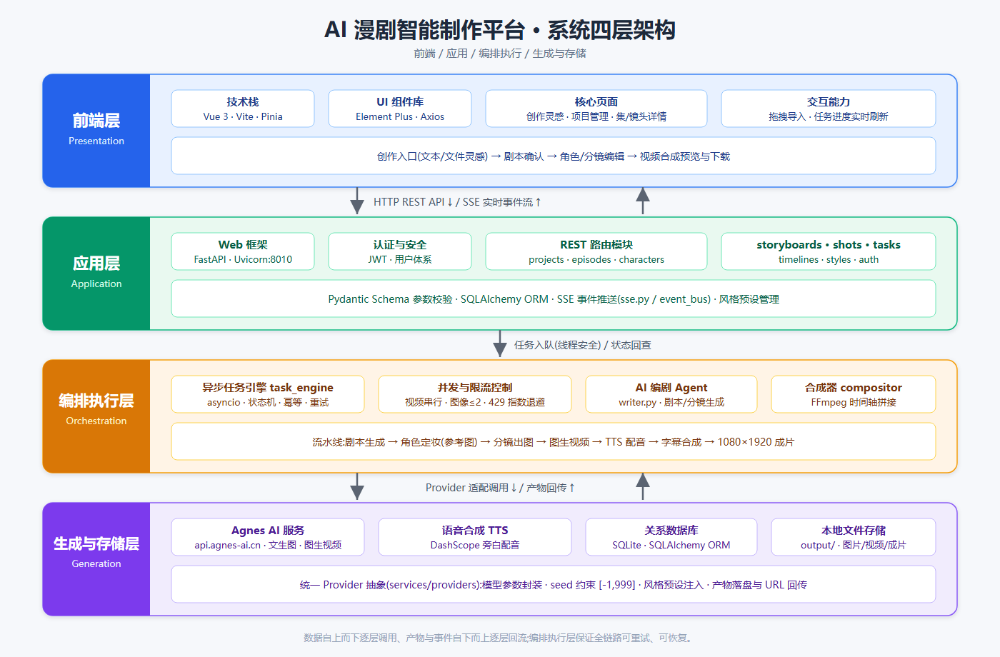

# AI 漫剧智能制作平台

基于多模态大模型的 AI 漫剧（漫画短剧）创作平台：从剧本到分镜、角色、镜头、视频合成，一条流水线完成整集漫剧的生产。

后端 FastAPI 负责项目/剧集/分镜数据与 AI 任务调度，前端 Vue 3 提供工作台、创作与编辑界面，AI 能力由 Agnes AI（文本/图像/视频）与阿里云 DashScope（TTS）提供，FFmpeg 负责音视频合成。



## 功能概览

| 模块 | 说明 |
|---|---|
| 账号体系 | 注册 / 登录 / 找回密码，JWT 双令牌（access + refresh），登录失败锁定 |
| 工作台 | 项目列表、进度总览、任务队列 |
| 创作流程 | 剧本 → 剧集 → 分镜（storyboard）→ 角色（character）→ 镜头（shot）→ 时间线（timeline） |
| 风格预设 | 内置漫剧风格模板，支持自定义并应用到项目 |
| AI 任务 | 异步任务引擎 + SSE 实时推送进度，失败可重试 |
| 视频合成 | FFmpeg 合成画面与 TTS 配音，产物落在 `backend/storage`，通过 `/static` 对外提供 |

## 技术栈

| 层 | 技术 |
|---|---|
| 后端 | Python 3.10+ / FastAPI / SQLAlchemy 2.0 / Pydantic v2 / Uvicorn |
| 数据库 | MySQL 8（`utf8mb4`），启动时自动建库建表 |
| AI | Agnes AI（文本、图像、视频）、DashScope TTS、DeepAgents 编排 |
| 媒体 | FFmpeg（由 `imageio-ffmpeg` 提供可执行文件） |
| 前端（主） | Vue 3 / Element Plus / Pinia / Vue Router / Vite 5 |
| 前端（React 版） | React 18 / antd 5 / Zustand / React Router 7 / Vite 5 / Vitest |

## 目录结构

```
drama/
├── backend/
│   ├── app/
│   │   ├── main.py            # FastAPI 入口，/health、/static 挂载
│   │   ├── core/              # 配置(config.py)、数据库(db.py)、鉴权(security.py)
│   │   ├── api/               # 路由：auth / projects / episodes / storyboards /
│   │   │                      #       characters / shots / tasks / timelines / sse
│   │   ├── models.py          # SQLAlchemy ORM 模型
│   │   ├── schemas.py         # Pydantic 请求响应模型
│   │   ├── services/          # 任务引擎、事件总线、合成器、AI Provider、存储
│   │   └── tests/             # pytest 测试与验证脚本
│   ├── migrations/            # 增量 SQL 迁移（建表由 ORM 自动完成）
│   ├── requirements.txt
│   └── .env.example           # 配置模板，需复制为 .env
├── frontend/                  # Vue 3 版前端（start.ps1 启动的就是它）
├── frontend-react/            # React 版前端（并行重写版本，见其 README）
├── docs/                      # 模块设计与测试报告
├── figures/                   # 架构图与需求图
├── PRD.md                     # 产品需求文档
├── start.ps1                  # 一键启动（自动装依赖）
└── stop.ps1                   # 一键停止
```

## 快速开始

### 1. 环境要求

- Python **3.10+**
- Node.js **18+**（Vue 版用 npm / React 版用 pnpm）
- MySQL **8.x**，已启动并知道 root 密码
- Windows PowerShell 5.1+（`start.ps1` 依赖 PowerShell）

### 2. 克隆

```bash
git clone git@github.com:zhizhnagertong/AI-drama.git
cd AI-drama
```

### 3. 配置 `backend/.env`（**必做**，此文件不入库）

```powershell
Copy-Item backend\.env.example backend\.env
```

然后填写：

| 变量 | 必填 | 说明 |
|---|---|---|
| `DB_HOST` / `DB_PORT` | 否 | 默认 `localhost:3306` |
| `DB_USER` / `DB_PASSWORD` | **是** | 你本机 MySQL 的账号密码 |
| `DB_NAME` | 否 | 默认 `ai_manga_studio2`，**库不存在会自动创建** |
| `AGNES_API_KEY` | AI 功能必填 | Agnes AI 密钥，文本/图像/视频生成依赖它 |
| `DASHSCOPE_API_KEY` | TTS 必填 | 留空时语音合成相关接口返回 400 |
| `JWT_SECRET` | 建议改 | 生产环境务必替换为随机串 |
| `STORAGE_DIR` | 否 | 产物目录，默认 `backend/storage` |

> 没填 AI Key 也能启动，界面与数据流程可用，只是 AI 生成类任务会失败。

### 4. 启动

```powershell
powershell -ExecutionPolicy Bypass -File .\start.ps1
```

脚本会自动完成：创建 `backend/.venv` → 安装 Python 依赖（清华镜像）→ `npm install`（npmmirror）→ 启动前后端 → 健康检查。

停止：

```powershell
powershell -ExecutionPolicy Bypass -File .\stop.ps1
```

### 5. 访问

| 地址 | 说明 |
|---|---|
| http://localhost:5173 | 前端（Vue 版） |
| http://localhost:8010/health | 后端健康检查 |
| http://localhost:8010/docs | Swagger API 文档 |

### 手动启动（可选）

```powershell
# 后端
cd backend
python -m venv .venv
.\.venv\Scripts\python.exe -m pip install -r requirements.txt
.\.venv\Scripts\python.exe -m uvicorn app.main:app --host 0.0.0.0 --port 8010 --reload

# 前端（另开终端）
cd frontend
npm install
npm run dev
```

前端 `vite.config.js` 已把 `/api` 与 `/static` 反代到 `localhost:8010`，无需额外配置接口地址。

## React 版前端

`frontend-react/` 是并行的 React 重写版本，与 Vue 版共用同一后端（同样反代 8010）：

```bash
cd frontend-react
pnpm install
pnpm dev        # 端口与 Vue 版冲突时先停掉 Vue 版
pnpm test       # Vitest
pnpm build      # tsc --noEmit && vite build
```

## API 一览

统一前缀 `/api/v1`，完整定义见 `/docs`：

| 前缀 | 模块 |
|---|---|
| `/auth` | 注册、登录、刷新令牌、找回密码 |
| `/projects` | 项目 CRUD、封面 |
| `/episodes` · `/storyboards` · `/characters` · `/shots` · `/timelines` | 创作流水线各环节 |
| `/styles` | 风格预设 |
| `/tasks` | 任务提交、查询、重试 |
| `SSE` | 任务进度实时推送 |

## 测试

```bash
# 后端（需可用的 MySQL）
cd backend
.\.venv\Scripts\python.exe -m pytest app/tests

# React 前端
cd frontend-react
pnpm test
```

## 常见问题

**`git clone` 报 `Connection was reset`**
本机到 `https://github.com` 的连接可能被重置，改用 SSH（`git@github.com:...`，需已配置 SSH Key），或先配好代理（`git config --global http.proxy http://127.0.0.1:7890`）。

**启动后 8010 端口报数据库连接错误**
检查 MySQL 是否启动、`backend/.env` 中的用户名密码是否正确。数据库和表由 `init_db()` 在启动时自动创建，无需手工执行 SQL。

**依赖安装很慢或失败**
`start.ps1` 已使用国内镜像（pypi 清华源、npm npmmirror）。若仍失败，删掉 `backend/.venv` 或 `frontend/node_modules` 后重试。

**端口被占用**
后端固定 8010、前端 5173。先运行 `stop.ps1`，或修改 `start.ps1` 中的端口与 `frontend/vite.config.js`。

**AI 生成任务失败**
确认 `AGNES_API_KEY` / `DASHSCOPE_API_KEY` 已填且额度充足；查看 `backend/uvicorn.log` 与 `backend/uvicorn.err.log`。

## 相关文档

- [产品需求文档 PRD.md](PRD.md)
- [剧集模块设计](docs/episodes-module.md)
- [风格预设 API](docs/style-presets-api.md) · [风格预设 UI](docs/style-presets-ui.md) · [风格预设测试报告](docs/style-presets-test-report.md)
- [模型选型说明](Agnes%20AI%20模型选择.md)

## 仓库说明

本仓库只跟踪**源码与文档**。以下内容被 [.gitignore](.gitignore) 排除，需要自行准备或生成：

- `backend/.env`（配置与密钥）
- `backend/.venv`、`frontend/node_modules`、`frontend-react/node_modules`（依赖，脚本会自动安装）
- `backend/storage`、`output/`、`ppt_work/`、日志与缓存
- Word / Excel / PPT 等办公文档（课程报告、答辩 PPT 等）